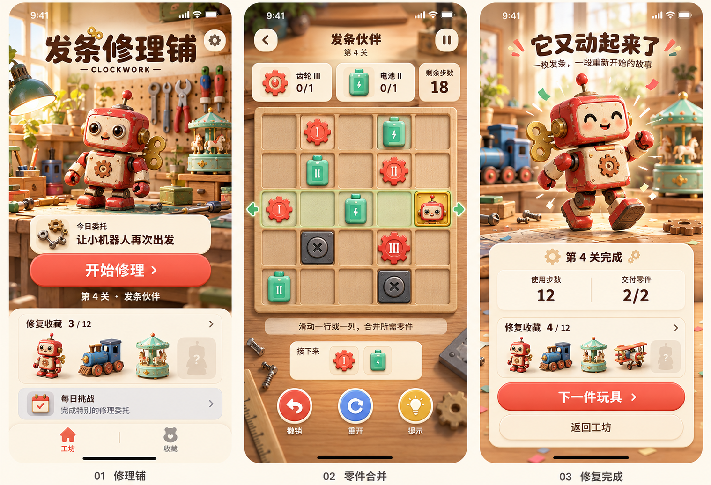

# 发条修理铺原型与交互规范

本次采用玩具修理铺三屏视觉原型。原型用于确定视觉风格与页面重点，正式游戏以产品规则及本文件的计数、等级与页面状态要求为准。

生成方式：内置 imagegen。保留[原始提示词](assets/Lirtrilner-Clockwork-prompt-v1.txt)供后续素材生成参考。原型为静态合成图，不能作为已运行应用的截图或直接作为交互界面。

## 视觉方向

复古玩具修理铺，以暖木工作台、珊瑚红控件、薄荷绿电池与黄铜发条建立识别。主角为红白发条机器人，其他玩具有小火车、音乐盒等。立体场景由二维素材表达。

| 设计项 | 初始实现规范 |
| --- | --- |
| 页面底色 | 奶油白 #FFF7E8 |
| 主操作色 | 珊瑚红 #E95B45；文字颜色与最终底色需做对比度验证 |
| 辅助色 | 薄荷绿 #78BDA8、深蓝 #405C78 |
| 主文字 | 深棕 #35271F |
| 字体 | 系统字体；标题使用较圆润字形，正文避免装饰字体 |
| 圆角 | 内容卡片约 18 pt，按钮约 22 pt，格子约 10 pt |
| 间距 | 8 pt 基础步进；页面左右建议 20 pt |
| 触控 | 常用按钮点击区域至少 44×44 pt，格子按可用宽度等分 |
| 图形 | 同类型零件轮廓一致；类型由轮廓和色彩共同区分 |
| 等级 | 所有零件显示 I、II、III 或 IV，不能仅依赖颜色 |

颜色和尺寸为设计起点，适配与可读性优先。大图背景上的正文放入稳定底色卡片中，避免随纹理失去对比度。

## 三个主页面

| 页面 | 主要内容 | 交互与状态 |
| --- | --- | --- |
| 工坊主页 | 当前玩具、维修阶段、继续按钮、关卡入口、每日挑战、收藏进度 | 新用户、维修中、当天已挑战、全通关；设置按钮可见 |
| 零件合并 | 订单、剩余步数、5×5 棋盘、补给预告、撤销、重开、提示 | 轨道选择、动画中、待交付、补给等待、失败、暂停 |
| 维修结算 | 当前阶段成果、步数、交付数、玩具进度、继续按钮 | 普通阶段完成、整件玩具完成、章节完成、最终通关 |

第 1、2 阶段结算使用“维修进行中”和对应阶段文案；第 3 阶段才使用“它又动起来了”。阶段未完成整件玩具时，主按钮为“继续维修”；完成整件玩具时为“下一件玩具”；最后一件完成后为“查看全部收藏”。

## 补齐的辅助页面规格

这些页面尚无独立高保真图，按与三屏相同的设计系统实施，不以不存在的视觉稿代替交互定义。

| 页面 | 必需信息 | 操作及空状态 |
| --- | --- | --- |
| 关卡选择 | 三章节、36 关、完成标记、最佳步数 | 未解锁关解释前置条件；已完成关可重玩 |
| 收藏列表与详情 | 12 件玩具、维修阶段、完成图、简短故事 | 空收藏说明完成前三关可收集机器人；详情可重播动作 |
| 每日挑战 | 当天日期、题号、循环说明、完成记录 | 昨日未完成局提供继续或切换今日；切换不覆盖主线 |
| 规则手册 | 局部移动、同级合并、交付、补给与障碍示例 | 分页可重看，不弹出首次体验的长篇说明 |
| 设置 | 音乐、音效、触觉、规则、隐私、支持、版本、重置 | 重置进度二次确认；外部链接失败显示说明 |
| 暂停 | 继续、重开、返回工坊 | 返回保存当前局；重开提示将重置本关 |
| 失败 | 失败原因、撤销、重开、返回 | “步数用完”与“无可执行操作”分别说明 |
| 存档异常 | 可恢复的备份或重开当前关 | 不静默清除全部进度；恢复方式清楚可见 |

## 原型图必须修正的地方

| 当前图示 | 正式版处理 |
| --- | --- |
| 第 4 关与收藏 3/12、4/12 同时出现 | 第 4 关属于第 2 件玩具第 1 阶段；完成前后收藏均为 1/12，阶段变为 1/3 |
| 第 4 关仍展示机器人完全修复 | 第 1～3 关为机器人；第 4～6 关切换小火车，并按阶段展示 |
| 部分电池只有闪电标记 | 保留类型符号，同时明确加上 I～IV 等级 |
| 棋盘只展示交付标记 | 正式界面增加可交付高亮、点击交付反馈和不匹配说明 |
| 没有明确补给入口 | 在指定格标记入口；堵塞显示“等待入口空出”，保留后续两枚预告 |
| 收藏数字直接增加 | 仅第三阶段首次完成时增加，复玩与每日挑战均不增加 |
| 图中文字嵌在图片里 | 所有按钮、标签和数值使用原生控件，可本地化和更新 |
| 未展示设置与失败页 | 按本文件辅助页面规格实现并验收 |

## 棋盘交互

手指按下记录格子，不立即移动。位移达到方向判定阈值后，以较大轴锁定方向并高亮整行或整列；建议阈值从 12 pt 开始真机调试。抬手提交一次操作，取消手势不改变状态。零件可以从空格起手选择轨道，点击交付格与滑动通过阈值区分。

移动约 180～240 ms，合并弹跳约 100～140 ms，交付反馈约 200 ms，具体以真机手感调整。动画期间锁定棋盘输入；切后台中断动画后，前台直接渲染已提交状态，不等待旧回调。

开启系统减弱动态效果时减少弹跳、旋转与庆祝粒子，保持信息反馈。音效与触觉分别可关闭。VoiceOver 为格子提供坐标、类型、等级及可交付状态，并通过自定义操作选择行列方向；不可仅依赖手势教学。

## 素材清单与制作方法

| 素材组 | 首版交付要求 |
| --- | --- |
| 工坊背景 | 主页、游戏背景、结算背景，适配裁切安全区 |
| 玩具 | 12 件；每件待修复图、维修中图、完成图及收藏缩略图 |
| 动画部件 | 需要旋转或摆动的发条、手臂、轮子独立透明层 |
| 棋盘 | 托盘、空格、障碍、交付、入口和选中状态 |
| 零件 | 齿轮与电池各 4 级，独立透明素材，文字等级原生叠加 |
| 界面 | 图标、按钮状态、进度条和卡片，由代码与轻量资源组合 |
| 应用图标 | 以原创机器人或发条为主，单独设计，不截取原型整图 |
| 音频 | 轻量背景音乐、移动、合并、交付、完成与失败反馈 |

素材按实际点尺寸及 @2x/@3x 导出放入 Asset Catalog，非透明背景优先使用适合的压缩格式，透明部件使用 PNG。每项记录来源、授权或生成过程。所有角色需保持比例与特征一致。

首版先验收机器人、小火车和一组完整棋盘，再批量生产其余玩具。正式界面素材不能依赖未经分层的三屏大图。商店图必须来自实际构建中的页面，真实体现应用使用状态。[Apple 截图要求](https://developer.apple.com/help/app-review/guideline-reference/2-3-3-screenshots)

